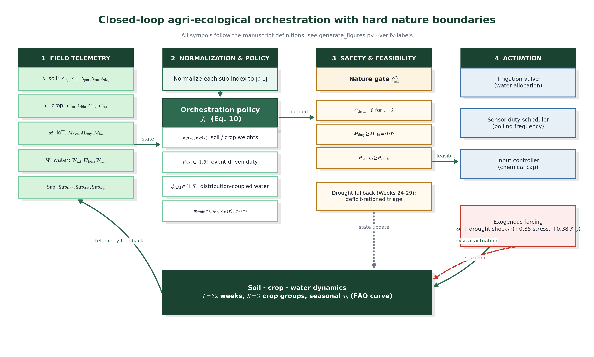
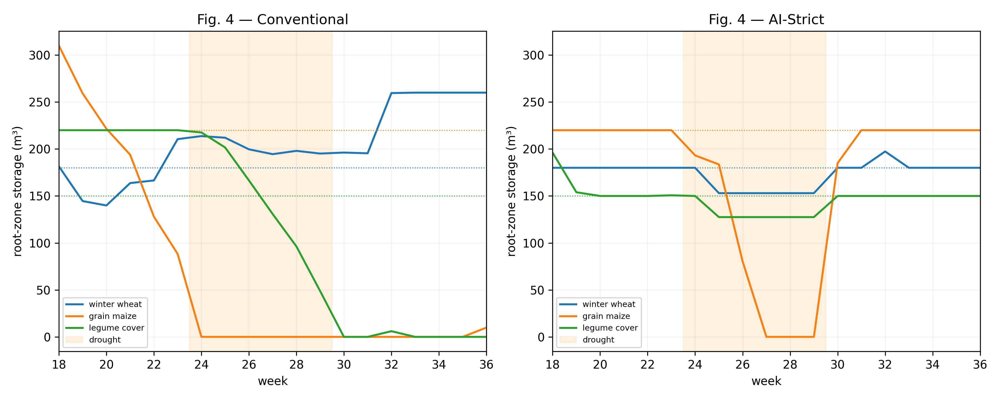

# A Multi-Tier Agri-Ecological Optimization Framework with Adaptive State-Dependent Orchestration and Nature-Boundary Gatekeeping

[-1e40af?style=flat-square)](#research-status--citation)
[](#research-status--citation)
[](#framework-overview)
[-0f766e?style=flat-square)](#experimental-protocol)
[](#experimental-protocol)
[](#repository-structure)
[](#license)

**Author:** Osama AlWaly  
**Affiliation:** Computer and Control Engineering Department, Port Said University, Egypt

---

## Research Status & Citation

> **Ongoing Research Notice:** This work is still **under research and not yet published**. `paper_revised_2.tex` is intentionally **withheld** for now and will be added once all final review considerations, multi-seed simulation runs, and final outcomes are complete.

- **Future Citation Support:** When `paper_revised_2.tex` is added, a `CITATION.cff` file and a complete **BibTeX** entry will be provided in this repository so the paper can be cited directly.
- **Interim Citation:** While under research, please cite only this repository when referencing the simulation notebook, figure scripts, or generated figures.

```bibtex
% Placeholder - to be finalized once paper_revised_2.tex and final research outcomes are added
@unpublished{alwaly_multi_tier_agri_ecological,
  author = {AlWaly, Osama},
  title  = {A Multi-Tier Agri-Ecological Optimization Framework with Adaptive State-Dependent Orchestration and Nature-Boundary Gatekeeping},
  note   = {Research in progress / manuscript under revision; code and simulation assets available at https://github.com/OsamaGharibElwaly/multi-tier-agri-ecological-optimization-framework}
}
```

---

## Framework Overview

A coupled **52-week** agri-ecological optimization framework across five subsystems separating physical evaluation metrics from within-tier objective diagnostics:

| Subsystem | Scope & Formulation | Key Controls & Guardrails |
| :--- | :--- | :--- |
| **Soil ($S \in [0,1]$)** | Organic matter ($S_{\mathrm{org}}$), microbial activity ($S_{\mathrm{mic}}$), porosity ($S_{\mathrm{por}}$), and available nutrients ($S_{\mathrm{nut}}$) contrasted against degradation ($S_{\mathrm{deg}}$) | State-scheduled weights ($\alpha_{\mathrm{AAI}}$) and degradation penalties |
| **Crop ($C \in [0,1]$)** | Nutritional/yield index ($C_{\mathrm{nut}}$), biodiversity ($C_{\mathrm{bio}}$), and varietal diversity ($C_{\mathrm{div}}$) across $K=3$ crop groups (winter wheat, grain maize, legume cover crop) under abiotic stress ($C_{\mathrm{ext}}$) | State-scheduled weights ($\mu_{\mathrm{AAI}}$) and non-compensatory clipped synergy at $\tau=2$ |
| **IoT ($M \in [0,1]$)** | Active electrical draw ($M_{\mathrm{elec}}$), duty-cycle fraction ($M_{\mathrm{duty}}$), and hardware overhead ($M_{\mathrm{hw}}$) | Event-gated scaling ($\beta_{\mathrm{AAI}} \in [1.0, 5.0]$) and minimum duty floor ($M_{\min}$) |
| **Water ($W$)** | Extraction ($W_{\mathrm{ext},t}$), distribution loss ($W_{\mathrm{loss},t}$), rainfall ($W_{\mathrm{rain},t}$), and net depletion $\Delta W_{\mathrm{net},t}$ | Evapotranspiration weight ($\omega_t$), scaling ($\phi_{\mathrm{AAI}} \in [1.0, 5.0]$), root-zone floor ($W_{\mathrm{crit},k}$), and drought fallback |
| **Supplier ($\mathrm{Sup}$)** | Technology availability ($\mathrm{Sup}_{\mathrm{tech}}$), distribution efficiency ($\mathrm{Sup}_{\mathrm{dist}}$), and compliance context ($\mathrm{Sup}_{\mathrm{reg}}$) | Coupled into seasonal cost factor $\kappa_t$ and scaling bounds |

### Operational Configurations ($\tau \in \{0, 1, 2\}$)
- **`Conventional`:** Fixed rule-based schedule without state-dependent adaptation.
- **`AI-Low` ($\tau = 0$):** Additive transitional regime with relaxed resource penalties.
- **`AI-Med` ($\tau = 1$):** Balanced regime with moderate resource penalties.
- **`AI-Strict` ($\tau = 2$):** Non-compensatory clipped multiplicative soil–crop core ($[\cdot]_+$), squared depletion penalty ($p(2)=2$), strict zero chemical input ($C_{\mathrm{chem}} = 0$), active nature gate ($\mathbb{I}_{\mathrm{nat}}^{(2)}$), and deterministic drought fallback policy.

---

## Experimental Protocol

- **Horizon & Crops:** 52 weekly steps ($t = 1, \dots, 52$ across Spring, Summer, Autumn, and Winter) over $K = 3$ crop groups with deterministic seeds.
- **Summer Drought Stress Test (Weeks 24–29):** Six-week disturbance applying a $+0.35$ climate stress increment and $+0.38$ soil-degradation shock across all four configurations to evaluate gate activation ($\mathbb{I}_{\mathrm{nat}}^{(2)} = 0$) and fallback recovery.
- **Physical Evaluation Metrics:** Anchored on physical units—yield ($\mathrm{t/ha}$), water ($\mathrm{m}^3$), sensor energy ($\mathrm{kWh}$), and soil organic carbon change ($\Delta\mathrm{SOC}$ in $\mathrm{g/kg}$)—treating $\mathcal{J}_{\tau}$ strictly as a within-tier diagnostic.

### Key Visual Assets

| Closed-Loop Architecture | Drought Stress Test (Weeks 24–29) |
| :---: | :---: |
|  |  |

---

## Repository Structure

```text
.
├── README.md                                        # Research overview, badges, status, and citation plan
├── .gitignore                                       # Excludes paper_revised_2.tex and build/cache files
├── generate_figures.py                              # Top-level figure generator script
├── references.bib                                   # Verified BibTeX references
├── fig1_closed_loop_architecture.png                # Top-level closed-loop architecture figure
├── fig2_tier_progression.png                        # Top-level strictness tier progression figure
├── Figure_3_Synergy_Contour.png                     # Top-level synergy contour figure
├── Figure_4_Drought_Stress_Test.png                 # Top-level drought stress-test figure
├── Figure_5_Radar_Comparison.png                    # Top-level radar comparison figure
├── notebooks/
│   └── agentic_ai_agro_ecological_optimization.ipynb  # Simulation and optimization notebook
├── scripts/
│   └── generate_figures.py                          # Figure generation script inside scripts/
├── figures/
│   ├── fig1_closed_loop_architecture.png
│   ├── fig2_tier_progression.png
│   ├── Figure_3_Synergy_Contour.png
│   ├── Figure_4_Drought_Stress_Test.png
│   └── Figure_5_Radar_Comparison.png
├── results/                                         # Multi-seed simulation outputs and summary tables
└── data/
    └── references/                                  # Reference PDFs, extracted_sources.md, and references.bib
```

---

## Roadmap

- [ ] Complete multi-seed ($N \ge 20$) simulation runs and populate `mean ± SD` physical outcome tables in `results/`.
- [ ] Add `paper_revised_2.tex` after all final review considerations and outcomes are complete.
- [ ] Add `CITATION.cff` and finalize the BibTeX entry for direct citation of the paper.

---

## License

This repository is released under the **MIT License** for academic and research use.